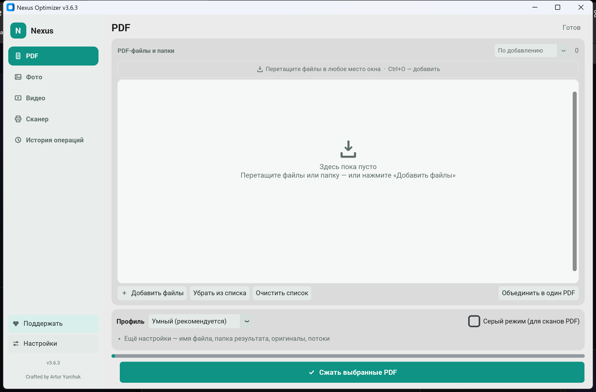
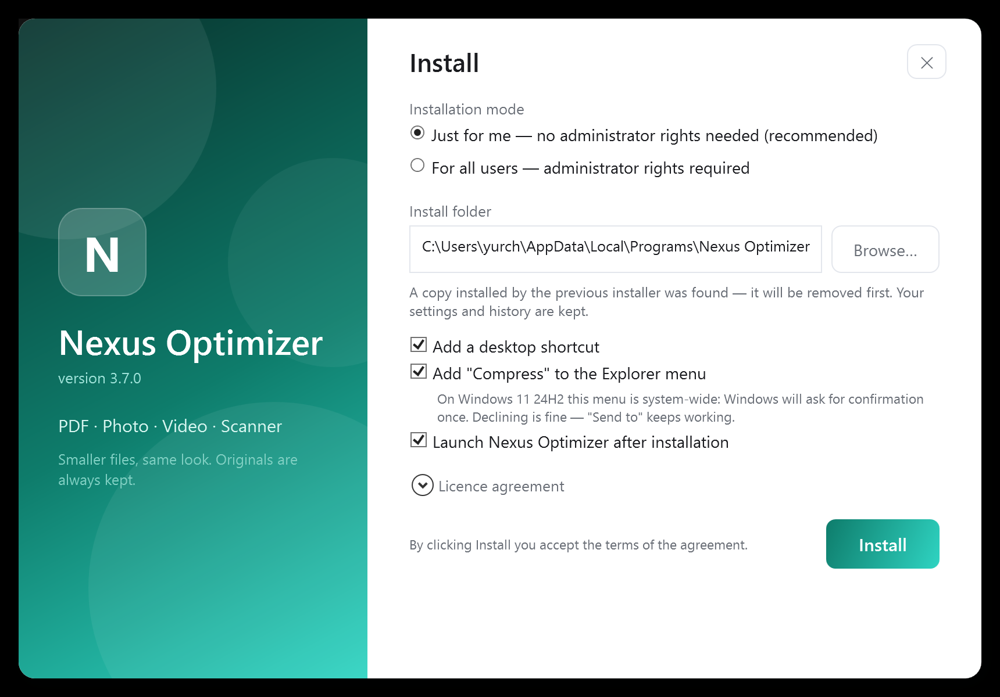

<div align="center">


# Nexus Optimizer

### Smaller files, same look — on your own computer.

Compress PDFs, photos and video, and scan straight to PDF. Everything runs on
your own processor: no account, no upload, no subscription. Originals are kept
until you say otherwise.

[](https://nexus.internetdeco.com) [](https://nexus.internetdeco.com) [](https://www.python.org/) [](LICENSE) [](#privacy)

**[Download](https://nexus.internetdeco.com)** · [Website](https://nexus.internetdeco.com) · [Support the work](#support-the-work)



</div>

## Support the work

Nexus Optimizer is free and stays free — no subscription, no paid tier, no ads.
It is written by one person in his own time. If it saved you an hour, a coffee is
a fair trade.

<div align="center">

[](https://buymeacoffee.com/clfankitm8) [](https://nexus.internetdeco.com/#support) [](https://nexus.internetdeco.com/#support)

</div>

| Method | Details |
| --- | --- |
| **Buy Me a Coffee** | [buymeacoffee.com/clfankitm8](https://buymeacoffee.com/clfankitm8) — card, one-off or monthly |
| **Binance Pay** | ID `90127003` |
| **USDT · TRC20** | wallet address below |

```text
TLbuKujXxfZgAobVsQZ9igTFiGCB12x6Tq
```

All methods, with QR codes, are on the
[website](https://nexus.internetdeco.com/#support). Stars and bug reports help
just as much as money.

## What it does

| Feature | Details |
| --- | --- |
| **PDF compression** | A "smart" profile reads the document and picks its own settings. Scans, text documents and mixed files are treated differently, and the structure survives. |
| **Photos** | Batch resize and recompress, JPEG/PNG/WebP, HEIC and AVIF from phones, ICC profiles kept, EXIF orientation applied. |
| **Video** | H.264, H.265, AV1 and VP9 with GPU encoding — Intel QSV, NVENC, AMF or Media Foundation, detected automatically and falling back to the processor. |
| **Scan to PDF** | WIA and TWAIN, the driver's own window, several pages collected into one file, with the real physical page size. |
| **Explorer menu** | "Compress with Nexus Optimizer" on files and folders, plus a "Send to" shortcut that keeps working on Windows 11 24H2. |
| **Originals preserved** | No code path deletes a source file before the result is confirmed written. |
| **Folders, not just files** | Drop a folder, optionally recurse, choose where results go and how they are named. |
| **History** | Every run recorded: what was processed, how much was saved, where the files went. |

Interface in Russian and English, light and dark themes following Windows.

## The installer

<div align="center">



</div>

Installs for the current user without administrator rights, or for everyone.
It upgrades a copy left by the previous (Inno Setup) installer, keeping settings
and history, and uninstalling removes the program, its shortcuts, the Explorer
menu entry and the settings folder.

## Privacy

Files are processed locally and never uploaded. There is no account, no licence
server and no telemetry. The log stays in `%APPDATA%\NexusOptimizer` and never
contains file contents.

## System requirements

- Windows 10 version 21H2 or Windows 11, 64-bit
- About 700 MB of free disk space
- 4 GB of memory; 8 GB is more comfortable for video
- No Python installation needed — the runtime is included
- No internet connection required, during install or afterwards

## Installing

Download `NexusOptimizer-Setup-<version>.exe` from the
[website](https://nexus.internetdeco.com) and run it. It installs for the current
user by default and needs no administrator rights.

Silent install:

```powershell
NexusOptimizer-Setup-3.7.0.exe /S
NexusOptimizer-Setup-3.7.0.exe /S /allusers /nodesktop
NexusOptimizer-Setup-3.7.0.exe /S /dir="C:\Apps\Nexus Optimizer" /nomenu
```

## Building from source

Requires Windows, Python 3.11+, the [.NET 10 SDK](https://dotnet.microsoft.com/download)
and [WiX 5](https://wixtoolset.org/) (`dotnet tool install --global wix`).

```powershell
./build_installer.ps1
```

This creates the virtual environment, builds the application with PyInstaller,
runs the tests, packages the MSI and produces the branded installer in
`artifacts/`. The version comes from `APP_VERSION` in `NexusPDFOptimizer.py` and
from nowhere else.

To run from source without building:

```powershell
python -m venv .venv
.\.venv\Scripts\pip install -r requirements.txt
.\.venv\Scripts\python NexusPDFOptimizer.py
```

## Licence

Nexus Optimizer is licensed under the **GNU Affero General Public License v3.0** —
see [LICENSE](LICENSE).

The reason is MuPDF: PDF compression uses PyMuPDF by Artifex Software, which is
distributed under the AGPL-3.0. Bundling it means the combined work carries the
same licence. FFmpeg, also bundled, is a GPL-3.0 build and is compatible with it.

In practice: you may use, study, modify and redistribute Nexus Optimizer, and
anyone who distributes a modified version must publish their source under the
same terms.

Third-party components and their licences:
[THIRD_PARTY_NOTICES.md](THIRD_PARTY_NOTICES.md).

## TWAIN

TWAIN support is a first-party `ctypes` binding to `twaindsm.dll`, written
against the public TWAIN specification. Earlier versions used the `pytwain`
package, which is GPL-2.0-only and therefore incompatible with both AGPL-3.0
(PyMuPDF) and GPL-3.0 (FFmpeg) — shipping them together was not permitted.

The 64-bit TWAIN Data Source Manager is bundled because Windows does not include
one and not every scanner driver installs it; its provenance and checksums are
recorded in [twaindsm.README.md](twaindsm.README.md).

## Known limitations

- The builds are not code-signed, so SmartScreen warns on download. A SHA-256
  checksum is published with every release.
- Video encoding on a machine without a supported GPU falls back to the
  processor and is correspondingly slower.
- The TWAIN path is exercised against the real Data Source Manager, but the full
  scan cycle depends on the scanner's own driver.

---

<div align="center">

Crafted by Artur Yurchuk

</div>
